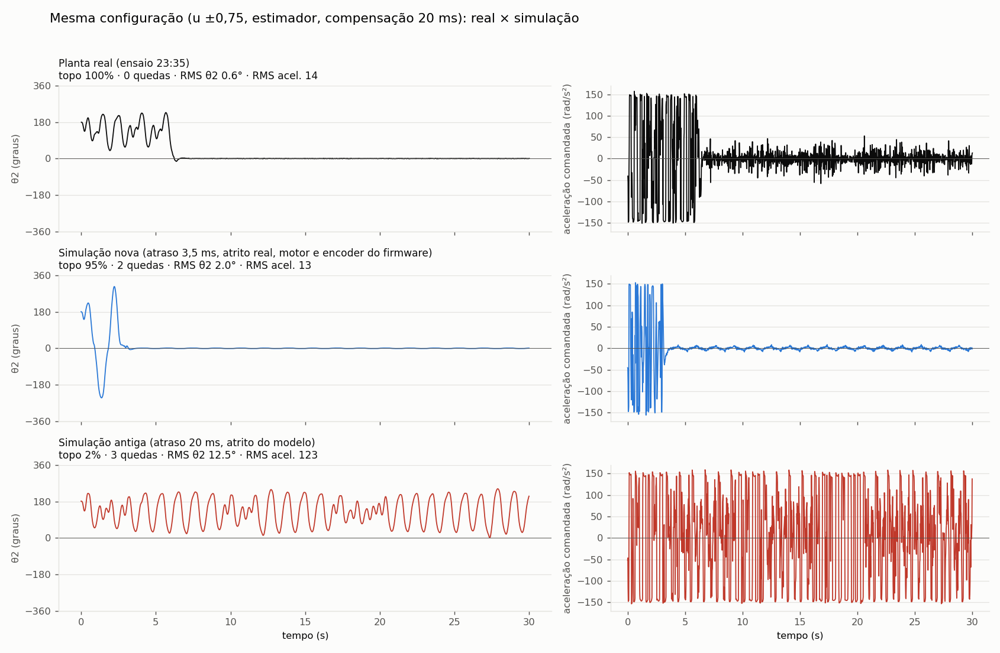

# Pêndulo de Furuta com CHRONOS

Swing-up e equilíbrio de um pêndulo de Furuta real com um **NMPC qLPV** resolvido pelo
[CHRONOS](https://github.com/arielmb94/CHRONOS-MPC) (ponto interior), reescrito em C e rodando embarcado num
**ESP32-S3**. O controle segue o artigo do ICIT 27 (modelo qLPV, laço iterativo dos ρ, terminal DLQR). O mesmo
código do controlador roda no simulador do PC e no firmware.

A operação é pelo [TraceView](https://github.com/AlisonTristao/TraceView): comandos num terminal e gráficos ao vivo,
pelo protocolo BTP numa única USB.



---

## Conteúdo

- [Visão geral](#visão-geral)
- [Modelo do pêndulo](#modelo-do-pêndulo)
- [O controlador](#o-controlador)
- [Hardware](#hardware)
- [Clonar e compilar](#clonar-e-compilar)
- [Operação pelo TraceView](#operação-pelo-traceview)
- [Configuração (furuta.ini)](#configuração-furutaini)
- [Simulador no PC](#simulador-no-pc)
- [Organização do código](#organização-do-código)
- [Resultados](#resultados)

---

## Visão geral

```
                 USB nativa (TinyUSB CDC, BTP)
  TraceView  ◀──────────────────────────────▶  ESP32-S3
  terminal + gráficos                           │
                                                ├─ núcleo 0: malha de 1 kHz (motor de passo, encoder, chaves)
                                                │            comunicação BTP, shell, telemetria
                                                └─ núcleo 1: NMPC (CHRONOS) a cada Ts = 20 ms
```

- O **motor de passo** impõe a aceleração do braço (θ̈1). Uma malha de 1 kHz gera os passos, satura velocidade e
  aceleração e freia antes dos fins de curso.
- O **encoder magnético** (AS5600, I2C) mede o ângulo do pêndulo θ2. O ângulo do braço θ1 vem da contagem de passos.
- O **NMPC** calcula, a cada 20 ms, o torque virtual u. O firmware o converte na aceleração do braço pelo modelo.

## Modelo do pêndulo

Estado $x = (\theta_1, \theta_2, \dot\theta_1, \dot\theta_2)$, com θ1 o braço e θ2 o pêndulo ($\theta_2 = 0$ no
topo). Parâmetros agrupados:

$$
\alpha = I_1 + m_2 L_1^2,\quad \beta = m_2 l_2^2,\quad \gamma = m_2 L_1 l_2,\quad \delta = I_2 + m_2 l_2^2,\quad
\eta = m_2\, g\, l_2
$$

Dinâmica (Euler-Lagrange) com torque u no braço e atrito viscoso μ1, μ2:

$$
\begin{bmatrix} \alpha + \beta \sin^2\theta_2 & \gamma\cos\theta_2 \\ \gamma\cos\theta_2 & \delta \end{bmatrix}
\begin{bmatrix} \ddot\theta_1 \\ \ddot\theta_2 \end{bmatrix} =
\begin{bmatrix}
u - \mu_1\dot\theta_1 - \beta\sin(2\theta_2)\,\dot\theta_1\dot\theta_2 + \gamma\sin\theta_2\,\dot\theta_2^2 \\
-\mu_2\dot\theta_2 + \tfrac12\beta\sin(2\theta_2)\,\dot\theta_1^2 + \eta\sin\theta_2
\end{bmatrix}
$$

**Com o motor de passo.** O braço segue a aceleração comandada $a = \ddot\theta_1$, então só a equação do pêndulo
importa:

$$
\ddot\theta_2 = \frac{\eta\sin\theta_2 + \tfrac12\beta\sin(2\theta_2)\,\dot\theta_1^2 - \mu_2\dot\theta_2 -
\gamma\cos\theta_2\; a}{\delta}
$$

Só L1, l2, I2 e μ2 (escalados por m2) precisam ser físicos. I1 e μ1 definem um braço "virtual" que converte o
torque do MPC em aceleração ($\ddot\theta_1 \approx u / (I_1 + m_2 L_1^2)$).

**Forma qLPV.** A dinâmica é escrita como $\dot x = A_c(\rho)\,x + B_c(\rho)\,u$, com 8 parâmetros de escalonamento
$\rho = f_\rho(x)$ (usando $\operatorname{sinc}\theta_2$ para ficar bem definido em θ2 = 0). Em cada estágio do
horizonte, (A, B) vem da discretização com ρ congelado:

| `mpc.discretizacao` | método | custo |
|---|---|---|
| `zoh` (padrão) | `expm` do bloco $h\,[A_c\ B_c;\ 0\ 0]$, exata para o modelo congelado | ~7 produtos 5×5 |
| `rk4` | Taylor de ordem 4 (= um passo de RK4 de sistema linear) | 3 produtos 5×5 |
| `euler` | $I + hA_c$ | nenhum produto |

O código está em [comum/modelo.c](comum/modelo.c).

**Parâmetros identificados** (pêndulo real, [pc/furuta.ini](pc/furuta.ini)):

| | valor | origem |
|---|---|---|
| L1 | 0,0791 m | efetivo, regressão nos ensaios de swing-up (medido: 9,145 cm) |
| m2 | 14,1 g | haste + moeda |
| l2 | 0,1078 m | regressão (medido: 8,5 cm) |
| I2 | 1,9036·10⁻⁵ kg·m² | regressão |
| μ2 | 1,4094·10⁻⁴ N·m·s | regressão (o atrito real é seco; este é o viscoso equivalente) |
| I1, μ1 | 0,005 / 0,001 | braço virtual (artigo) |

`furuta -ident <l2>` refaz a identificação (oscilação livre com o braço travado → I2 e μ2).

## O controlador

NMPC qLPV ([comum/qlpv_mpc.c](comum/qlpv_mpc.c)), com o QP resolvido pelo CHRONOS
([comum/chronos.c](comum/chronos.c)):

1. **Estimador:** dθ2 estimado com o modelo e o θ̈1 comandado. O observador puro do encoder era ruidoso demais.
2. **Compensação do atraso:** prediz o estado 20 ms à frente, porque o comando calculado só vale no próximo período.
3. **Laço dos ρ:** a trajetória prevista define ρ em cada estágio. Com ela, resolve-se um QP, que dá uma trajetória
   nova. Repete até $\lVert\Delta\rho\rVert_\infty < \varepsilon$ ou `l_max` QPs. O QP parte da solução anterior
   (warm start).
4. **Horizonte de passo variável:** Np = 6 estágios cobrindo 0,8 s, com o passo crescendo em reta. Equivale a Np ≈ 40
   uniforme a uma fração do custo.
5. **Custo:** Q nos estados, Rdu na variação de u, peso exponencial ao longo do horizonte e custo terminal DLQR
   no topo.
6. **Restrições:** u e Δu duras; θ1 (curso do braço, vindo do homing) e |dθ| suaves, com folgas L1.

No ESP32 o controlador roda em `float`, com `-O3` e da IRAM. Com a configuração padrão o passo leva em média
~2,8 ms (máximo ~15 ms) dos 20 ms disponíveis. `furuta -bench` mede isso por etapa.

## Hardware

| | |
|---|---|
| Microcontrolador | ESP32-S3 N16R8 (16 MB flash, 8 MB PSRAM), USB nativa para o PC |
| Motor | de passo, 200 passos/volta, micropasso 16, direto no braço |
| Driver | DRV8825 (STEP/DIR, nENABLE, nFAULT, M0-M2) |
| Encoder do pêndulo | AS5600 (I2C, 12 bits) |
| Fins de curso | uma chave em cada lado do braço (homing e proteção) |

Pinos em [firmware/components/furuta/config.h](firmware/components/furuta/config.h). **Os pinos do S3 ainda são
provisórios.** Para testar a placa montada use `pinos -entradas`, `pinos -i2c` e `pinos -motor`.

| Sinal | GPIO | | Sinal | GPIO |
|---|---|---|---|---|
| STEP | 4 | | M0 / M1 / M2 | 15 / 16 / 17 |
| DIR | 5 | | FIM_NEG / FIM_POS | 10 / 11 |
| nENABLE | 6 | | SDA / SCL | 8 / 9 |
| nFAULT | 7 | | | |

## Clonar e compilar

As bibliotecas de comunicação ([BTPDevice](https://github.com/AlisonTristao/BTPDevice),
[BTP](https://github.com/AlisonTristao/BTP), [TinyShell](https://github.com/AlisonTristao/TinyShell)) são submódulos
git, fixados no commit testado com este firmware:

```
git clone --recursive https://github.com/AlisonTristao/furuta_pendulum_with_chronos.git
```

Se você já clonou sem `--recursive`, rode `git submodule update --init`. Rode de novo depois de um `git pull` que
mude os submódulos.

> No Windows, clone numa pasta de caminho curto (ex. `C:\git`). O ESP-IDF estoura o limite de 260 caracteres de
> caminho ao copiar o tinyusb.

### Firmware

Requer o [PlatformIO](https://platformio.org/) (CLI ou extensão do VS Code). Ele baixa sozinho a plataforma
`espressif32 @ 7.0.1` (ESP-IDF 6.0.1) e as dependências fixadas no `dependencies.lock`.

```
cd firmware
pio run                 # compila
pio run -t upload       # grava
```

**Para gravar**, segure BOOT, aperte RESET e solte BOOT: a placa entra no modo de gravação. Depois de gravar, o
esptool reinicia o chip pelo watchdog e o firmware sobe sozinho. A gravação sem os botões (toque de 1200 baud) ainda
não é confiável.

O ambiente `esp32s3_debug` (`pio run -e esp32s3_debug -t upload`) mostra os logs do boot no USB-Serial-JTAG antes
de a USB passar para o BTP.

## Operação pelo TraceView

1. Instale o [TraceView](https://github.com/AlisonTristao/TraceView/releases).
2. Conecte a placa pela USB nativa e conecte no dispositivo serial **furuta**.
3. No terminal, `help` lista todos os comandos.

| Comando | O que faz |
|---|---|
| `furuta -home` | homing pelos fins de curso (liga o driver, mede o curso e define o limite de software) |
| `furuta -origem` | θ1 = 0 na posição atual, sem homing (limite ±0,5 rad) |
| `furuta -zera` | pêndulo parado embaixo: θ2 = π |
| `furuta -start` | ensaio com controle: impulso inicial, swing-up e equilíbrio |
| `furuta -dry` | a seco: calcula o controle com os sensores, sem mover o motor |
| `furuta -stop` | para o ensaio |
| `furuta -sim` | ensaio simulado em tempo real, com telemetria, contra a planta calibrada (não usa o motor) |
| `furuta -bench` | tempo do MPC por etapa, com planta simulada (não usa o motor) |
| `furuta -ident <l2>` | identificação por oscilação livre → I2, μ2 |
| `furuta -status` / `-driver <0\|1>` | estado da malha / liga ou desliga o DRV8825 |
| `cfg -set secao.chave=valor` | muda a configuração até o próximo boot (listas com espaço: `cfg -set mpc.Q=10 100 5 1`) |
| `cfg -show` / `cfg -reset` | configuração em uso / volta ao `furuta.ini` embutido |
| `pinos -entradas` / `-i2c` / `-motor` | teste de bancada |

Sequência típica: `furuta -home`, depois `furuta -dry` para conferir os sinais, depois `furuta -start`.

**Tópicos** para plotar:

| Tópico | Taxa | Campos |
|---|---|---|
| `controle` | a cada período do MPC (ensaio) | t, θ1, θ2, dθ1, dθ2, u, a, n_qp, n_it, t_calc, estouros |
| `sensores` | 50 Hz | θ1, θ2, θ2_topo (0 = topo), dθ1, dθ2 |
| `maquina` | 2 Hz (texto) | estado da malha, fase do ensaio, chaves, nFAULT, encoder |

### Testar sem o pêndulo: furuta -sim

`furuta -sim` roda um ensaio completo dentro da ESP, em tempo real (um passo a cada Ts), com o mesmo controlador e o
mesmo orçamento de tempo do `furuta -start`. A planta é a do simulador do PC ([comum/planta.c](comum/planta.c), seção
`[sim]` do `furuta.ini`): atrito seco, encoder de 12 bits, θ1 em passos inteiros, saturações da malha de 1 kHz e
atraso de um período. Os tópicos `controle` e `sensores` mostram a simulação como se fosse o pêndulo real; o motor
não se mexe. Para outro ensaio, mude a semente: `cfg -set sim.semente=3`. No fim sai um resumo: tempo de subida,
fração no topo, tempo do MPC e da planta e estouros.

### Comparar métodos com o bench

```
furuta -bench
cfg -set mpc.discretizacao=rk4
furuta -bench
cfg -set mpc.Np=8
furuta -bench
```

Cada execução imprime uma tabela com o tempo médio, o máximo e a fração do passo em cada etapa: estimador,
compensação, warm start, predição, rollout, QP (e as etapas internas do CHRONOS) e atualização dos ρ.

## Configuração (furuta.ini)

[pc/furuta.ini](pc/furuta.ini) é a fonte única da configuração. Ele é **embutido no firmware** na compilação e é
lido pelo simulador. Cada chave tem um comentário com a origem do valor e os testes que a justificam.

- `[fisico]`: parâmetros do pêndulo.
- `[mpc]`: horizonte, pesos, restrições, discretização, laço dos ρ.
- `[ensaio]`: Ts, duração, modo (swing-up ou só equilíbrio), impulso inicial, estimador, compensação do atraso.
- `[sim]`: só o simulador (planta calibrada nos ensaios reais, atrito seco, ruído, atraso).

[pc/artigo.ini](pc/artigo.ini) tem o pêndulo e a configuração do artigo.

## Simulador no PC

Requer gcc e make (MinGW-w64 no Windows: `mingw32-make`).

```
cd pc
make                                        # sim.exe (double) e sim_f.exe (float, como no ESP32)
./sim.exe furuta.ini saida.csv              # malha fechada com o controlador do firmware
./sim.exe furuta.ini saida.csv mpc.Np=8     # sobrescreve chaves na linha de comando
```

Com `ensaio.embarcado = 1`, o simulador reproduz o firmware (atraso fixo de um período, mesmo `controlador.c`). A
simulação é sensível às condições iniciais: compare configurações com várias sementes usando
[pc/sim_estat.py](pc/sim_estat.py). [pc/graficos.py](pc/graficos.py) plota um CSV. [pc/regressao.py](pc/regressao.py)
ajusta os parâmetros físicos a partir de ensaios reais.

## Organização do código

```
comum/                 controlador em C99, compartilhado PC/firmware
  modelo.c             dinâmica, ρ, discretização (zoh/rk4/euler)
  chronos.c            CHRONOS: QP por ponto interior, perfil por etapa
  qlpv_mpc.c           NMPC: laço dos ρ, horizonte variável, terminal DLQR
  estimador.c          estimador de dθ2
  controlador.c        um passo do controle: estimador + compensação + MPC
  config.c             leitura do .ini
pc/                    simulador e scripts de análise
firmware/
  src/main.cpp         a camada BTP: comandos, tópicos, ligação com o TraceView
  src/gravacao.cpp     gravação sem botões (em aberto)
  components/furuta/   núcleo em C: malha de 1 kHz, motor, encoder, homing, ensaio, bench, ident
  components/mpc/      compila comum/ para o ESP32 (float, -O3, IRAM)
  extern/              submódulos BTPDevice, BTP, TinyShell
```

O núcleo em C não conhece o BTP: imprime por `saida.c`, e o `main.cpp` liga essa saída ao terminal do TraceView.
Para mexer na comunicação, só se edita o `main.cpp`. Para mexer no controle, só `comum/` e `components/furuta/`.

## Resultados

Ensaios reais de swing-up (30 s cada) em [pc/resultados/metricas_swingup.md](pc/resultados/metricas_swingup.md).
Com estimador e compensação de 20 ms, o pêndulo sobe em ~2-6 s e fica 97-100% do tempo no topo, com RMS de θ2 entre
0,6° e 1,5°. Sem eles, o controle ficava agressivo (4-9°, com quedas frequentes).
